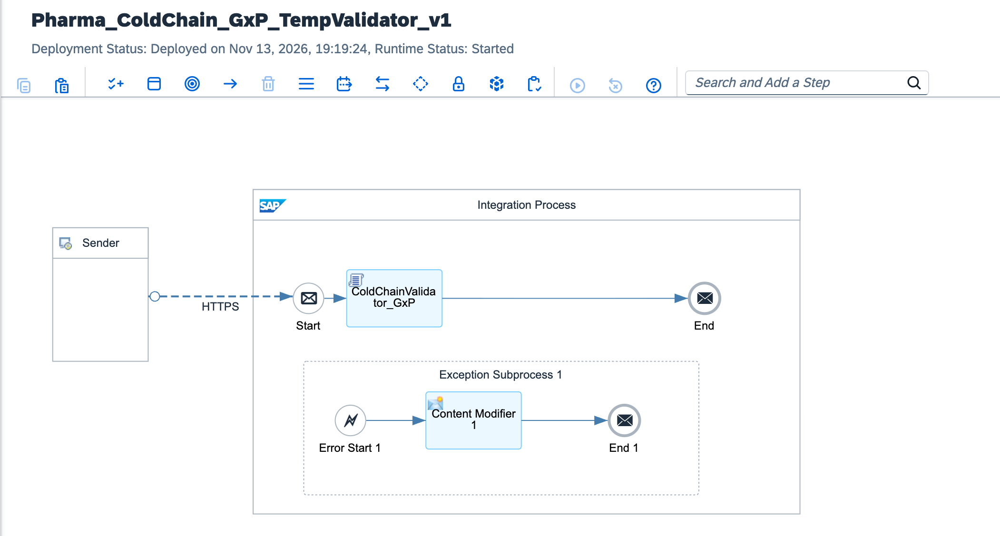

# SAP Cloud Integration Pharma Cold-Chain QA: Spock TDD & GitOps CI/CD

[](https://github.com/neurozeljko/sap-cpi-pharma-coldchain-tdd-cicd/actions/workflows/ci-cd-piper.yml)
[](https://www.sap.com)
[](#3-spock-framework-unit-test--message-mocking)
[](#6-architectural-decision-record-adr-026)

An enterprise-grade **Test-Driven Development (TDD)** and **GitOps CI/CD** architecture for **SAP Cloud Integration (CPI)** governing **CRISPR / mRNA ultra-cold chain pharmaceutical logistics**. Instead of manually clicking *"Deploy"* on unverified Groovy scripts inside SAP BTP, every code change is automatically validated against a **Spock Framework** unit test suite mocking `com.sap.gateway.ip.core.customdev.util.Message` and gated through **GitHub Actions** and **SAP Project Piper**.

---

## 1. Live Verification & CI/CD Evidence

### 1.1. Automated GitHub Actions & Spock TDD Pipeline (`Passed`)
Every `git push` triggers a full Gradle build executing 10 data-driven Spock specifications against mocked SAP CPI `Message` interfaces before unlocking the SAP Project Piper deployment stage:


### 1.2. SAP Cloud Integration Runtime (`Pharma_ColdChain_GxP_TempValidator_v1`)
Verified Groovy transformation and `Exception Subprocess` error handling deployed onto the SAP Integration Suite (`eu10`) runtime tenant following CI/CD quality gate clearance:



---

## 2. GitOps & TDD Pipeline Architecture

```text
  [ Integration Architect / Developer ]
                 │
                 │ git push origin main (Groovy + Spock Spec + iFlow)
                 ▼
  ┌────────────────────────────────────────────────────────────────────────┐
  │ 1. GitHub Actions CI Quality Gate (.github/workflows/ci-cd-piper.yml)  │
  │                                                                        │
  │   [Gradle SourceSet Isolation]                                         │
  │   ├── compileStub: com.sap.gateway.ip.core.customdev.util.Message      │
  │   ├── main:        ColdChainValidator.groovy (Pure SAP CPI Script)     │
  │   └── test:        ColdChainValidatorSpec.groovy (Spock 2.3 Suite)     │
  │                                                                        │
  │   [Spock Verification Engine]                                          │
  │   ├── Mock(Message) intercepts getBody(), setHeader(), setBody()       │
  │   ├── @Unroll Matrix: Celsius, Fahrenheit (-94°F), Kelvin (203.15K)    │
  │   └── Excursion Detection: Outside [-80.0°C, -60.0°C] -> HTTP 422      │
  └──────────────────────────────────┬─────────────────────────────────────┘
                                     │
                     ┌───────────────┴───────────────┐
                     │                               │
              [TESTS FAILED]                  [ALL 10 TESTS PASSED]
                     │                               │
                     ▼                               ▼
       [ ❌ Pipeline Aborted ]        ┌────────────────────────────────────┐
       (Zero Risk to BTP Tenant)      │ 2. SAP Project Piper GitOps Gate   │
                                      │    (.pipeline/config.yml)          │
                                      │    Step: cpiArtifactDeploy         │
                                      └──────────────────┬─────────────────┘
                                                         │
                                                         ▼
                                      ┌────────────────────────────────────┐
                                      │ 3. SAP Integration Suite (CPI)     │
                                      │    Pharma_ColdChain_GxP_TempVal_v1 │
                                      │    Endpoint: /http/gxp/cold-chain  │
                                      │    Exception Subprocess: HTTP 400  │
                                      └────────────────────────────────────┘
```

---

## 3. Spock Framework Unit Test & `Message` Mocking

In SAP Cloud Integration, Groovy scripts depend tightly on the proprietary `com.sap.gateway.ip.core.customdev.util.Message` interface. This repository isolates that contract in a dedicated `compileStub` Gradle source set so **Spock Framework** can dynamically mock `Message` interactions (`1 * message.setHeader(...)`) in milliseconds:

```groovy
@Unroll
def "GxP Cold-Chain Evaluation: #scenario (#temp #unit -> #expectedCelsius C => #expectedStatus)"() {
    given: "An incoming IoT cold-chain telemetry JSON payload"
    def inputJson = """
    {
        "batchId": "MRNA-CRISPR-2026-089",
        "sensorId": "CRYO-LOG-04",
        "temperature": ${temp},
        "unit": "${unit}"
    }
    """
    message.getBody(String.class) >> inputJson

    when: "The SAP CPI Groovy script processes the message"
    def result = validator.processData(message)

    then: "The message headers and GxP compliance status are accurately set"
    1 * message.setHeader("X-GxP-Batch-ID", "MRNA-CRISPR-2026-089")
    1 * message.setHeader("X-GxP-Normalized-Temp-C", expectedCelsius.toString())
    1 * message.setHeader("X-GxP-Release-Status", expectedStatus)
    1 * message.setHeader("CamelHttpResponseCode", expectedHttpCode)

    where:
    scenario                       | temp   | unit | expectedCelsius | expectedStatus                          | expectedHttpCode
    "Optimal Celsius storage"      | -70.0  | "C"  | -70.0           | "RELEASED_FOR_PATIENT_ADMINISTRATION" | 200
    "US Fahrenheit cryo reading"   | -94.0  | "F"  | -70.0           | "RELEASED_FOR_PATIENT_ADMINISTRATION" | 200
    "Kelvin lab telemetry reading" | 203.15 | "K"  | -70.0           | "RELEASED_FOR_PATIENT_ADMINISTRATION" | 200
    "Critical warm excursion"      | -45.0  | "C"  | -45.0           | "QUARANTINE_THERMAL_EXCURSION"          | 422
    "Over-freezing excursion"      | -95.0  | "C"  | -95.0           | "QUARANTINE_THERMAL_EXCURSION"          | 422
}
```

---

## 4. Runtime Payload & GxP Quarantine Behavior

### 4.1. Valid Cryogenic Shipment (`HTTP 200 OK`)
**Input Payload (`-94.0°F` from US Biologics Hub):**
```json
{
  "batchId": "MRNA-CRISPR-2026-089",
  "sensorId": "CRYO-LOG-04",
  "temperature": -94.0,
  "unit": "F"
}
```

**Normalized SAP CPI Output & Audit Headers:**
```http
HTTP/1.1 200 OK
X-GxP-Batch-ID: MRNA-CRISPR-2026-089
X-GxP-Normalized-Temp-C: -70.0
X-GxP-Release-Status: RELEASED_FOR_PATIENT_ADMINISTRATION

{
    "gxpAuditRecord": {
        "batchId": "MRNA-CRISPR-2026-089",
        "sensorId": "CRYO-LOG-04",
        "originalReading": "-94.0 F",
        "normalizedCelsius": -70.0,
        "allowedRangeCelsius": "-80.0 to -60.0",
        "complianceStatus": "RELEASED_FOR_PATIENT_ADMINISTRATION",
        "regulatoryFramework": "EU Annex 11 / FDA 21 CFR Part 11"
    }
}
```

### 4.2. Thermal Excursion & Malformed Telemetry Handling
* **Thermal Excursion (`HTTP 422 Unprocessable Entity`):** If temperature drifts outside `-80.0°C` to `-60.0°C`, the script sets `QUARANTINE_THERMAL_EXCURSION` and returns `HTTP 422` to block automated batch release in SAP S/4HANA EWM.
* **Exception Subprocess (`HTTP 400 Bad Request`):** Empty payloads or unsupported scales throw an `IllegalArgumentException` caught by the CPI `Exception Subprocess`, returning a structured GxP QA hold response.

---

## 5. Repository Structure

```text
.
├── README.md                                                     # Executive architecture & TDD documentation
├── build.gradle                                                  # Gradle build with isolated SAP Message compileStub
├── settings.gradle                                               # Gradle root project definition
├── github-actions-spock-passed.png                               # Live GitHub Actions CI/CD green verification proof
├── sap-cpi-coldchain-groovy-deployed.png                         # Live SAP CPI iFlow deployment proof
├── .github/
│   └── workflows/
│       └── ci-cd-piper.yml                                       # GitHub Actions Spock TDD + Project Piper pipeline
├── .pipeline/
│   └── config.yml                                                # SAP Project Piper cpiArtifactDeploy configuration
├── docs/
│   └── adr/
│       └── ADR-026-tdd-spock-gitops-gxp.md                       # Architectural Decision Record (EU Annex 11 / FDA CSV)
├── iflow/
│   ├── Pharma_ColdChain_GxP_TempValidator_v1.zip                 # Exported SAP Integration Suite iFlow package
│   └── extracted/                                                # Unpacked BPMN2 (.iflw) & runtime resources
└── src/
    ├── compileStub/groovy/com/sap/gateway/ip/core/customdev/util/
    │   └── Message.groovy                                        # SAP CPI Message interface contract stub
    ├── main/groovy/com/sap/cpi/pharma/
    │   └── ColdChainValidator.groovy                             # Production SAP CPI Groovy transformation script
    └── test/groovy/com/sap/cpi/pharma/
        └── ColdChainValidatorSpec.groovy                         # Spock Framework BDD/TDD specification suite
```

---

## 6. Architectural Decision Record (ADR-026)

* **Status:** Accepted & Enforced in CI/CD
* **Context:** Manual deployment of unverified Groovy scripts into SAP BTP tenants introduces high regression risk in GxP-regulated pharmaceutical supply chains (EU Annex 11 / FDA 21 CFR Part 11).
* **Decision:** Enforce automated Spock Framework unit testing with mocked `Message` interfaces via GitHub Actions on every commit, gating SAP Project Piper deployments (`cpiArtifactDeploy`) on 100% test suite passage.
* **Consequences:** Thermal conversion regressions and missing Camel headers are caught in `<30 seconds` in CI before reaching SAP Integration Suite, while generating downloadable HTML verification artifacts for GxP quality audits.

---

**Integration Architect:** Željko Popov
